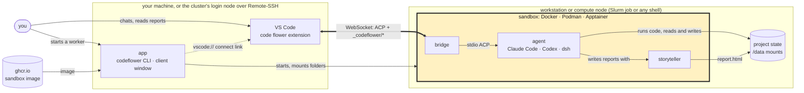

<p align="center">
  
</p>

<h1 align="center">code flower sandbox</h1>

<p align="center">The isolated image the agents work in, and the bridge to VS Code.</p>

<p align="center">
  <a href="https://github.com/lutrarutra/codeflower-app"> app</a>
  &nbsp;·&nbsp;
  <b> sandbox</b>
  &nbsp;·&nbsp;
  <a href="https://github.com/lutrarutra/codeflower-vsc-extension"> VS Code extension</a>
  &nbsp;·&nbsp;
  <a href="https://github.com/lutrarutra/storyteller"> storyteller</a>
  &nbsp;·&nbsp;
  <a href="https://codeflower.dev">codeflower.dev</a>
</p>

The isolated runtime image of a code flower worker, with all three agents (Claude Code, Codex,
and DeepSeek Harness), and the bridge that connects it to VS Code.

- `Dockerfile`, `entrypoint.sh`: the image (`codeflower-sandbox`) and its start script
- `package.json`: the agent runtimes, pinned exactly
- `bin/`: `codeflower-show`, `codeflower-pty`, `codeflower-env-export`, `codeflower-network`,
  `codeflower-doctor` for per-worker environment facts and live diagnostics, and
  `codeflower-inventory`, which describes the mounted data (formats, shapes, columns)
- `templates/`: the agent instructions copied into a new workspace, and those of `codeflower task`:
  `TASK.md` for every run, `task/continue.md` when a task is continued, `task/wrap-up.md` when its
  time or rounds run out
- `dsh-plugins/acp-ws/`: the authenticated ACP WebSocket bridge, session recorder, and sign-in relay
- `dsh-plugins/acp-ws/src/agents/<id>/`: one folder per agent, `agent.json` (name, launch script, home, credential
  variables, provider hosts, files to write once) and an optional `index.js` (login checks, where a key goes). To
  add an agent, add its folder and its adapter to `package.json`, then run `make agents` in the app, which embeds
  the descriptors

## How code flower fits together

The highlighted part is this repository, the sandbox, with the bridge inside it.



1. Start a worker with the app (`codeflower interactive`, or the client window), on a workstation or
   as a cluster job. It downloads the sandbox image once and starts it with your folders mounted.
2. The worker prints a `codeflower://` address. Paste it into the VS Code extension, or click the worker's
   link in the client window.
3. Chat with the agent in VS Code. The extension talks to the sandbox's bridge over one WebSocket; the
   bridge runs the agent, which sees only the mounted folders.
4. The agent writes its findings as storyteller reports, which open in VS Code beside the chat.

Releases are published as `ghcr.io/lutrarutra/codeflower-sandbox` for linux/amd64 and linux/arm64,
tagged `X.Y.Z`, `X.Y`, `latest` and `sha-<commit>`. The app downloads the `X.Y` it was tested
with (`codeflower pull`); to get it yourself:

```sh
docker pull ghcr.io/lutrarutra/codeflower-sandbox:0.1
apptainer pull codeflower-sandbox.sif docker://ghcr.io/lutrarutra/codeflower-sandbox:0.1
```

To build it locally:

```sh
make sandbox-build          # the image codeflower-sandbox (Docker)
make sandbox-build-linux    # build/codeflower-sandbox-amd64.tar for an x86_64 cluster (Apptainer)
make bridge-install bridge-test
```

The app ([codeflower-app](https://github.com/lutrarutra/codeflower-app)) starts
the image. The `CODEFLOWER_*` environment and `/opt/codeflower` paths it relies on are described
in the [architecture document](https://github.com/lutrarutra/codeflower-workspace/blob/main/docs/architecture.md).
At startup each worker writes its own snapshot under `run/`; `codeflower-doctor` reads that
snapshot and checks current resources and, when isolated, the current network allowlist. It
reports the allocation the app found (`CODEFLOWER_ALLOCATION_*`: the batch job's CPUs, memory,
GPUs and end, or `--cpus`, `--memory`, `--time-limit`) and the tightest cgroup limit above the
process, found through `/proc/self/cgroup` because Apptainer shows the host's cgroup tree.
It also writes a data inventory of `/data/input` there (`CODEFLOWER_INVENTORY_FILE`, at most
`CODEFLOWER_INVENTORY_SECONDS`, default 10 s), which the agent instructions point to.
For development, clone [codeflower-workspace](https://github.com/lutrarutra/codeflower-workspace),
which has this repo as the `sandbox/` submodule.
